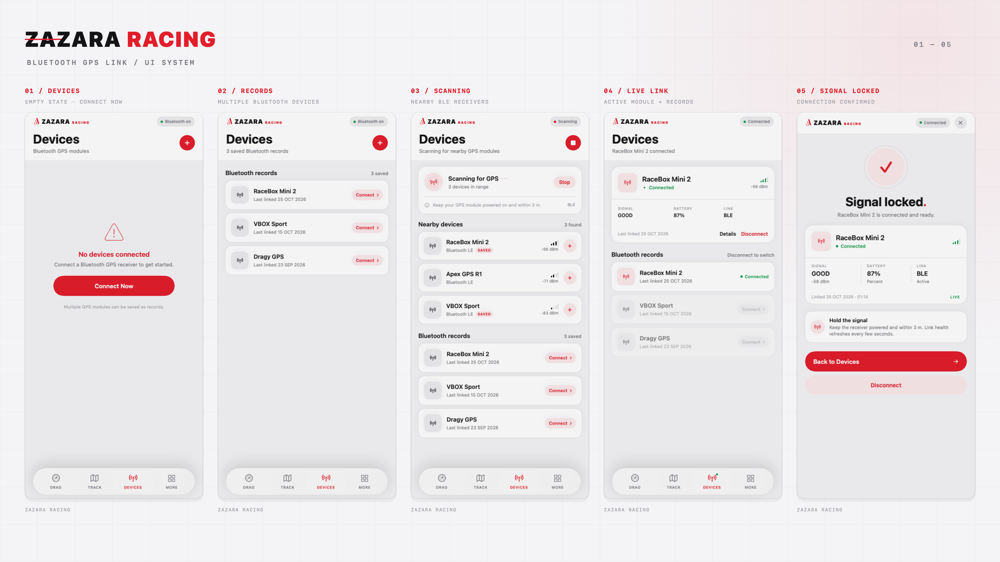
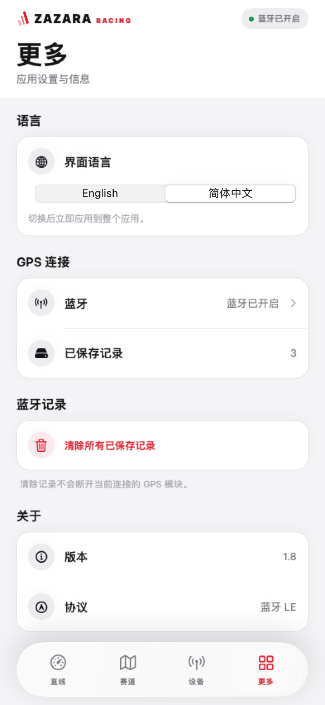
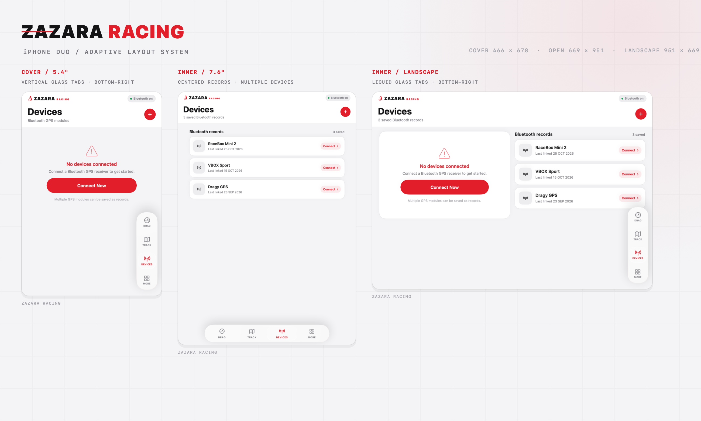

# ZAZARA RACING

赛道 GPS 蓝牙连接 App。SwiftUI + CoreBluetooth，深色石墨界面与 ZAZARA 红色品牌色。





## 语言 / Language

- 底部 `More / 更多` → `Language / 语言`
- 支持 `English` 与 `简体中文` 即时切换，整个 App 的标题、按钮、状态、日期和错误提示都会同步切换
- 首次启动默认跟随系统语言；手动选择后会保存到本机
- 蓝牙设备名称保持原样，便于识别硬件

## iPhone Duo



- Tab 栏改为**系统原生 `TabView`**：iOS 18+ 使用 `Tab` + `.tabViewStyle(.sidebarAdaptable)`，在 Duo 内屏横屏 / iPad 等宽屏布局下由系统自动变成右侧悬浮的 Liquid Glass sidebar；普通 iPhone 竖屏是系统底部 Tab 栏
- iOS 26+ 的玻璃材质、选中块的放大/缩小、融合/滑动过渡全部由系统绘制，不再手写玻璃效果
- iOS 16–17 使用经典 `TabView` + `.tabItem`（系统底部 Tab 栏）
- 页面内容的安全区由系统 TabView 自动处理；Duo 外屏 / 内屏 / 分屏切换不再需要手写断点判断
- 当前构建使用 Xcode 27.1 / iOS 27.1 SDK；用 Xcode 15 打开时会自动走经典 Tab 栏分支

> **关于旧 SDK 的小屏窗口**：iOS 会根据二进制的 `LC_BUILD_VERSION` SDK 版本决定 iPhone Duo 是否使用完整内屏。旧 SDK 产物默认会被系统放在一个手机比例的居中窗口里。`Scripts/make-unsigned-ipa.sh` 会在编译后用 `vtool` 将 SDK 标记为 27.1，供 Sideloadly 测试；这是非官方 workaround。若系统仍然显示小屏窗口，必须用 Xcode 27.1 / iOS 27.1 SDK 重新构建。

## 蓝牙设备发现

ZAZARA 硬件保留 RaceChrono 的 `0x1FF8` 服务，因此 RaceChrono 仍可正常发现和连接；同时增加一个 ZAZARA 专用的 128-bit 发现服务：

- Service：`848C50CF-2272-4E15-B32C-3183B3FB8BF6`
- Identity characteristic：`CDF36350-93B6-4BF9-A78E-61E08AA444BA`（READ）
- 广播：主广播包含 `0x1FF8` + ZAZARA Service，完整设备名放在 scan response
- App 扫描时只请求 ZAZARA Service；连接后再读取 Identity characteristic，校验 `ZAZARA` 前缀和身份协议版本

因此 App 只显示 ZAZARA 硬件，不会显示附近普通 BLE 设备或其他 RaceChrono DIY 设备。广播本身仍然是公开的；该方案是品牌发现/身份校验，不是访问控制。

每台设备会显示 `#XXXX` 短 ID。新固件把它放在广播名末尾（例如 `ZAZARA RACING #A1B2`），数值取自 BLE MAC 最后两个字节，因此同一台硬件在不同手机上显示相同 ID。旧固件或缓存中没有该后缀时，App 会临时回退到 iOS peripheral UUID 前 4 位。

> 该 App 版本必须配合带 ZAZARA 发现服务的固件使用；旧固件没有这个服务，升级 App 后不会被扫描到，请先烧录新固件。

## 核心流程

1. 启动进入 **Devices** 设备管理页；底部为 `TIMING / TRACK / DEVICES / MINE` 四个 Tab。
2. 没有记录时显示红色空状态，点击 **Connect Now** 扫描附近的 ZAZARA GPS 模块。
3. 每次配对成功都会保存一条 **Connection Records** 记录，支持保存多个不同的 GPS 模块；未连接的记录置灰显示，点击 **Connect** 即可重新连接。已保存的模块不会重复出现在 **New ZAZARA GPS** 扫描列表里，只会在连接记录中出现；扫描到已保存模块时，记录下方会显示绿色 **可连接 / Available to connect**。
4. 连接成功后停留在 **Devices** 页，顶部显示模块名、信号、连接类型、`#XXXX` ID、实时链路卡片和电量（若模块支持 Battery Service）。
5. 当前模块在记录列表中标记为 `Connected`；其他记录仍可查看，断开后可切换。删除当前连接记录会同时断开模块。
6. `Timing` 提供 Drag / Track 入口；从 Timing 进入的 Track 页分为「总览 / 仪表」：总览显示 12 块实时 GPS 数据卡，支持编辑并拖动排序；仪表为固定页面（不滚动），含半圆速度表、G 值点阵和 GPS 路程轨迹图，G 值/路程为正方形面板；宽屏按「左仪表 + 右上 G 值 + 右下路程」排列，直板/竖屏时 G 值与路程并排放在仪表下方。主 Tab 的「赛道」是赛道库，当前为待上线占位页。`Mine` 提供蓝牙状态、记录数量、清除记录和版本信息。

## 已实现

- CoreBluetooth 扫描 / 连接 / 断开 / 超时处理
- 按 ZAZARA 自定义 128-bit 服务过滤扫描结果
- 连接后读取 ZAZARA Identity characteristic 做品牌/协议版本校验
- 附近模块实时 RSSI 与信号格
- 多条连接记录持久化（UserDefaults），最多保存 12 个不同模块
- 未连接记录置灰，带独立 `Connect` 操作；当前连接记录高亮为 `Connected`
- 连接记录支持左滑删除；长按记录也可删除；More 页可一次清除全部记录
- 上次连接时间显示到秒（`HH:mm:ss`）
- 断线、蓝牙关闭、权限被拒、找不到设备等状态提示
- 连接成功后读取 Battery Service（180F / 2A19，可选）
- 订阅 RaceChrono `0x1FF8` 服务的 GPS 数据（`0x0003`）和时间（`0x0004`），解析 UTC 时间、卫星数、定位质量、经纬度、海拔、速度、方位角、HDOP/VDOP
- Timing → Track 页分「总览 / 仪表」：总览按 3 列网格显示 GPS 接收器数据，横屏为固定紧凑网格（不滚动，格子缩小以放下 4 行），竖屏可滚动；支持编辑模式拖动方块调整位置，并通过 `UserDefaults` 保存顺序
- Timing → Track 的仪表页（固定不滚动）：系统 `Gauge` + 自定义 `GaugeStyle` 的半圆速度表（初始 0–60 km/h，随速度自动扩大量程；半圆不拉伸，宽高不足时留空）、Swift Charts 的 G 值点阵图（横向/纵向 G 由 GPS 速度与方位角计算）、GPS 经纬度轨迹绘制的路程图和累计距离；G 值/路程为正方形面板，宽屏/竖屏自动切换布局
- 主 Tab「赛道」为赛道库待上线占位页，可跳转连接 GPS 设备；实时 Track 数据和仪表从 Timing → Track 进入
- 应用内中英文即时切换，设置本地持久化
- 系统原生 Tab 栏：iOS 18+ 自适应 sidebar（`.sidebarAdaptable`），iOS 16–17 经典 tab bar
- iOS 26+ 使用系统 Liquid Glass 和原生选中过渡，无需自定义玻璃/动画代码
- SwiftUI Previews 覆盖首次启动、记录、扫描、已连接、连接成功等状态
- 深色状态栏、白色 Accent Color（红色保留为品牌、按钮和仪表/数据强调色）、蓝牙权限文案与 Sideloadly 安装脚本已配置

## 运行

- 使用 Xcode 16+ 打开可获得 iOS 18+ 的自适应 sidebar；Xcode 15 会使用经典 Tab 栏
- 最低系统：iOS 16.0
- **蓝牙 LE 在模拟器中不可用，请使用真机测试配对流程**
- 首次点击添加 GPS 时会请求蓝牙权限

> Xcode 15.2 无法直接连接 iPhone 16 Pro Max（iOS 18+）进行调试，会报
> `kAMDMobileImageMounterPersonalizedBundleMissingVariantError`。
> 下面提供 Sideloadly 临时安装方式。

## 临时真机安装（Sideloadly + 免费 Apple ID）

已生成现成安装包：

`build/ZAZARA-RACING-unsigned.ipa`

重新生成：

```bash
./Scripts/make-unsigned-ipa.sh
```

该 IPA 最低支持 iOS 16.0，使用 iOS 27.1 SDK、arm64，已做 ad-hoc 签名；Sideloadly 会使用你的免费 Apple ID 重新签名后安装。

1. 在 Mac 安装 [Sideloadly](https://sideloadly.io)。（若捆绑 ID 冲突，在 Sideloadly 中勾选 Change Bundle ID。）
2. 用 USB 连接 iPhone 16 Pro Max，在手机上选择“信任此电脑”。
3. 在 iPhone 的 `设置 → 隐私与安全性 → 开发者模式` 打开开发者模式并重启。这个入口通常需要先尝试安装一次才会出现。
4. 把 `build/ZAZARA-RACING-unsigned.ipa` 拖进 Sideloadly，输入 Apple ID 和密码（或 App 专用密码），完成双重验证。
5. 安装完成后，在 iPhone 的 `设置 → 通用 → VPN 与设备管理` 中信任对应开发者证书。
6. 打开 **ZAZARA RACING**，允许蓝牙权限，点击 `Connect Now` 开始扫描。

注意事项：

- 免费 Apple ID 签名的 App **7 天后过期**；重新用 Sideloadly 安装一次即可刷新。
- 这种方式不能连接 Xcode 调试器，也看不到设备控制台日志。
- 测试包的 Bundle ID 是 `com.zazara.racing`；以后使用 Xcode 正式安装时会是独立的应用记录。
- Sideloadly 需要 Apple ID 凭据在本机完成签名，不会由项目或脚本保存。不要把 Apple ID 密码发给其他人。
- 该 IPA 使用 iOS 27.1 SDK 构建。如果未来 iPhone 系统版本拒绝启动旧 SDK 包，需要改用云 Mac/CI + 当前版本 Xcode 重新构建。

## 说明

- 当前已订阅 ZAZARA 固件实现的 RaceChrono GPS 协议（服务 `0x1FF8`，特征 `0x0003` / `0x0004`）。其他厂商的 GPS 协议仍需单独适配。
- Timing 页目前提供 Drag 计时入口与 Track 实时数据入口；Drag 的自定义指标仍只在当前会话中保留，重启 App 后会清空。
- 经典蓝牙（Bluetooth Classic / SPP）模块不会被 CoreBluetooth 扫描到，需要 MFi ExternalAccessory 方案。
- 历史记录只保存在当前设备上，不跨设备同步。
- 仪表页的 G 值由 GPS 速度变化和方位角变化推算，不是硬件加速度计数据；低速/无定位时可能为 0 或波动。
- 仪表页的「路程图」是 GPS 经纬度轨迹的归一化路径绘制（Canvas），不是地图瓦片；距离来自 GPS 累计里程。
- 界面支持应用内中英文切换；蓝牙权限系统弹窗仍由 iOS 根据系统语言显示。

## 开发约定

- **优先使用 SDK 内置 API**（SwiftUI / UIKit / CoreBluetooth / Foundation 等）；只有 SDK 没有对应能力时，才在项目内实现 workaround。
- 当前已使用系统 API 的部分：
  - Tab 栏：`TabView` + `Tab` + `.tabViewStyle(.sidebarAdaptable)`（iOS 18+），低版本 `TabView` + `.tabItem`
  - 详情页导航/返回：`NavigationStack` + 系统导航栏（`navigationTitle` / `toolbar`）
  - 语言切换：`Picker(.segmented)`；删除确认：`confirmationDialog`
  - Track 总览/仪表分段：居中浮动胶囊 tab（系统没有可直接内嵌的紧凑 tab 组件；用 `.ultraThinMaterial` + `matchedGeometryEffect` 实现，图标和红色选中态与主 Tab 一致）
  - Timing 的 Drag/Track 详情页不隐藏主 Tab：`.toolbar(.hidden, for: .tabBar)` 会让系统在返回时延迟恢复主 Tab
  - Duo 内屏横屏时，系统 `.sidebarAdaptable` 默认把主 Tab 侧栏放在左侧；仅在 Duo 内屏横屏（phone、约 1.4:1、宽 >900、高 >600）给 `TabView` 设 RTL，把侧栏放回右侧，同时各 Tab 内容强制 LTR，避免页面镜像。普通 iPhone / iPad 不触发
  - 仪表：SwiftUI `Gauge` + `GaugeStyle`；G 值点阵：Swift Charts `PointMark`
  - 蓝牙：CoreBluetooth；图标：SF Symbols；日期时间：Foundation `DateFormatter`
  - iOS 16 的 `onChange` 兼容：`zzOnChange` 内部优先走 iOS 17 API
- 保留自定义的部分是品牌/视觉设计（页面字标、卡片、按钮、赛道图形、信号格等）。添加指标弹窗、连接中遮罩目前是自定义视觉实现；若不需要特殊样式，可迁移到系统 `.sheet` / `.alert`。

## 代码结构

- `Localization.swift` — 中英文文案、语言偏好与日期本地化
- `DesignSystem.swift` — 深色主题、红色按钮/卡片、通用组件
- `GPSLinkManager.swift` — CoreBluetooth 状态机、历史记录、RSSI/电量、RaceChrono GPS 数据解析
- `ConnectGPSView.swift` — Devices 页、扫描、附近设备、连接记录、连接卡片
- `LinkedView.swift` — 已连接设备的详情页
- `AppShellView.swift` — 系统 `TabView`（iOS 18+ 自适应 sidebar）、`NavigationStack` 详情页、Timing / Drag 页面、赛道库占位页、Timing → Track 总览/仪表（速度表 + G 值图）、实时 GPS 数据网格、语言设置
- `ContentView.swift` / `ZAZARA_RACINGApp.swift` — App 入口与环境注入
- `Scripts/make-unsigned-ipa.sh` — 不依赖 Xcode 设备调试，生成可交给 Sideloadly 的 IPA
